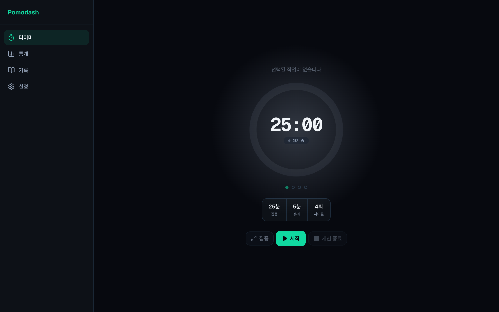
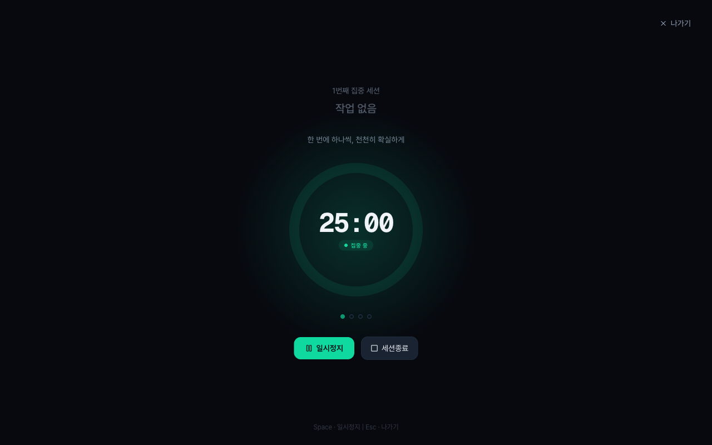
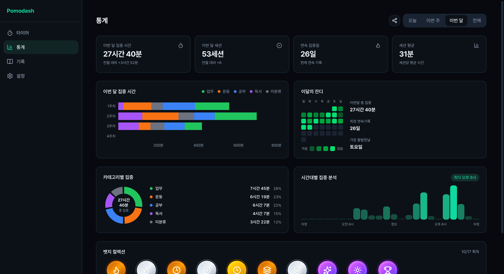

# PomoRoutine

[](https://pomoroutine.com) [](./LICENSE)

계획하고, 집중하고, 기록하는 포모도로 집중 도구

- 수험생과 취업 준비생을 위한 작업 계획 → 집중 타이머 → 회고 기록 → 통계 흐름
- 웹과 React Native 앱 동시 개발, 계정 하나로 기기 간 자동 동기화
- 서비스 https://pomoroutine.com

<div align="center">
  
  
  
</div>

## 핵심 기능

| 기능 | 설명 |
|---|---|
| 포모도로 타이머 | 집중과 휴식 자동 전환, 고정 사이클 없는 자유 모드 |
| 집중 모드 | 타이머와 동기부여 메시지만 남긴 전체 화면 |
| 회고 기록 | 메모, 집중도, 방해 요소 태그, 집중 구간 타임라인 |
| 통계 | 기간별 집중 시간, 스트릭, 카테고리와 시간대 분석, 월간 히트맵 |
| 뱃지와 공유 카드 | 스트릭, 누적 시간, 다양성 뱃지 수집과 집중 요약 이미지 공유 |
| 비회원 체험 | 로그인 없이 타이머 바로 사용 |

## 기술적 의사결정

**웹과 모바일의 로직 공유**
- 타이머 상태 머신, 통계 집계, 뱃지 판정을 `packages/shared`로 추출해 두 앱이 같은 코드 사용
- 저장소 차이는 포트 주입으로 분리 — 웹은 localStorage, 앱은 AsyncStorage

**하이브리드 앱 구조**
- 타이머와 설정은 네이티브, 통계와 기록 탭은 웹 화면을 WebView로 재사용
- 네이티브 로그인 세션을 WebView 쿠키로 넘기는 인증 브릿지로 재로그인 없이 연결

**낙관적 업데이트와 임시 ID 처리**
- 작업, 카테고리, 기록은 서버 응답 전에 화면에 먼저 반영하고 실패하면 되돌림
- 생성 직후 응답이 오기 전에 수정이나 삭제가 들어오면 늦게 온 응답이 변경을 덮어쓰는 문제
- 생성 요청이 끝날 때까지 기다린 뒤 실제 DB id로 처리하도록 변경 [#140](https://github.com/aaaz425/pomoroutine/pull/140)

**서버 집계와 이중 검증**
- 스트릭과 월간 히트맵처럼 전체 기록이 필요한 통계는 Postgres RPC에서 계산
- 전 테이블 RLS로 계정별 격리, 입력 제약은 클라이언트 Zod와 DB CHECK 양쪽에 동일하게 적용

## 트러블슈팅

**대시보드 성능 — 알고리즘이 아니라 데이터 흐름이 원인**
- 기록이 많아질수록 월간 히트맵 계산이 느려지는 문제
- Map 기반 O(n) 집계로 개선 [#114](https://github.com/aaaz425/pomoroutine/pull/114)
- 근본 원인은 클라이언트가 전체 기록을 받아 집계하는 구조로 판단, 집계를 DB RPC로 이전 [#136](https://github.com/aaaz425/pomoroutine/pull/136)

**CI e2e 간헐 실패 — 테스트 코드가 아니라 실행 환경이 원인**
- 실패 시 trace를 수집해 브라우저가 타임아웃 내내 완전히 멈추는 패턴 확인 [#151](https://github.com/aaaz425/pomoroutine/pull/151)
- 같은 VM에서 dev 서버 HMR 컴파일과 브라우저가 CPU를 다투는 것이 원인
- e2e를 프로덕션 빌드로 전환해 안정화, CI 실행 시간도 기존 최대 3분 9초에서 2분 9초로 단축 [#153](https://github.com/aaaz425/pomoroutine/pull/153)

## 기술 스택

| 영역 | 기술 |
|---|---|
| 웹 | Next.js 16 App Router, Tailwind CSS, shadcn/ui, Recharts, framer-motion |
| 앱 | React Native, Expo Router, react-native-reanimated, react-native-webview |
| 상태와 검증 | Zustand, Zod |
| 백엔드 | Supabase Postgres, Auth, RLS, Edge Functions |
| 테스트 | Vitest, Playwright, GitHub Actions |
| 인프라 | pnpm workspace, Turborepo, Vercel |

## 문서

| 문서 | 내용 |
|---|---|
| [PRD](docs/specs/PRD.md) | 문제 정의, 타겟 사용자, 기능 범위 |
| [기능 명세](docs/specs/feature-spec.md) | 기능별 사용자 스토리와 수용 기준 |
| [화면 명세](docs/specs/screen-spec.md) | 화면 구성과 인터랙션 |
| [ERD](docs/specs/ERD.md) | 데이터 모델과 설계 이유 |
| [아키텍처](docs/specs/architecture-diagram.md) | 시스템 구조와 핵심 설계 결정 |
| [디자인 시스템](docs/guides/design.md) | 색상, 타이포, 컴포넌트 규칙 |

개발 규칙 문서는 `CLAUDE.md`와 `docs/guides/`에 AI 에이전트 참고용으로 분리

## 로컬 실행

요구사항 Node.js 22+, pnpm 11+, 로컬 Supabase 사용 시 Docker

```bash
pnpm install
pnpm dev                      # 웹 http://localhost:3000
pnpm --filter mobile start    # 앱 Expo 개발 서버
pnpm test                     # 단위 테스트
pnpm test:e2e                 # e2e 테스트
```

로컬 Supabase 스택은 `npx supabase start` 후 출력된 `API_URL`, `ANON_KEY`를 `apps/web/.env.local`에 입력

## 라이선스

[MIT](./LICENSE) © 2026
