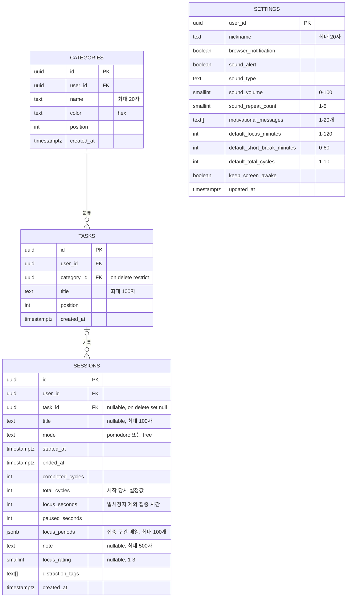

# ERD

- Supabase Postgres 기준, 원본은 `supabase/migrations/`
- 모든 테이블은 계정 단위로 격리

## 관계도

| 테이블 | 역할 |
|---|---|
| categories | 작업 분류, 유저당 최대 10개 |
| tasks | 집중할 대상, 제목과 카테고리만 보관 |
| sessions | 타이머 한 번의 실행 기록 |
| settings | 유저당 1행, 타이머 기본값과 알림, 메시지 설정 |

## 설계 결정

**계정 격리를 DB에서 강제**
- 모든 테이블에 RLS를 걸어 본인 행만 읽고 쓸 수 있게 함
- `user_id` 기본값을 `auth.uid()`로 두어 클라이언트가 소유자를 따로 보내지 않아도 되고, 다른 사람의 id로 쓰려는 요청은 RLS가 막음

**집중 시간은 별도 컬럼으로 저장**
- `ended_at - started_at`은 일시정지가 포함된 경과 시간이라 집계에 쓰지 않음
- 실제 집중 시간 `focus_seconds`를 따로 저장하고 모든 통계는 이 값만 사용

**집중 구간은 jsonb로 내장**
- 집중 구간은 항상 기록과 함께 조회하고 따로 조회할 일이 없어 별도 테이블 대신 배열로 저장
- 저장하기 전에 5초 미만 구간은 버리고, 5초 이하로 잠깐 멈춘 구간은 하나로 합쳐 최대 100개까지만 저장

**삭제 정책으로 기록 보존**
- 작업을 지워도 기록은 남기고 미분류로 전환 — `on delete set null`
- 작업이 쓰고 있는 카테고리는 삭제 불가 — `on delete restrict`

**입력 제약을 클라이언트와 DB에 이중 적용**
- 길이, 범위, 개수 제약을 Zod 스키마와 DB CHECK에 같은 값으로 설정
- DB 제약이 Zod보다 엄격하지 않게 맞춰 정상 입력이 DB에서 거부되는 일이 없게 함
- 카테고리 개수처럼 여러 행에 걸친 제약은 CHECK로 표현할 수 없어 트리거로 강제

**전체 기록이 필요한 통계는 RPC로 계산**
- 스트릭, 월간 히트맵, 직전 기간 비교, 가장 바쁜 요일은 `get_dashboard_summary`에서 계산
- 날짜 경계는 서버 시계가 아닌 사용자 시간대 기준
- 호출한 사용자의 권한으로 실행돼 RLS가 그대로 적용됨

**가입 시 기본 데이터 자동 생성**
- 회원가입 트리거가 기본 카테고리 5개와 설정 1행을 한 트랜잭션에서 생성

## 보조 테이블

- `email_check_rate_limits` — 가입 여부 확인 API의 IP 기반 호출 제한, 서비스 키로만 접근
