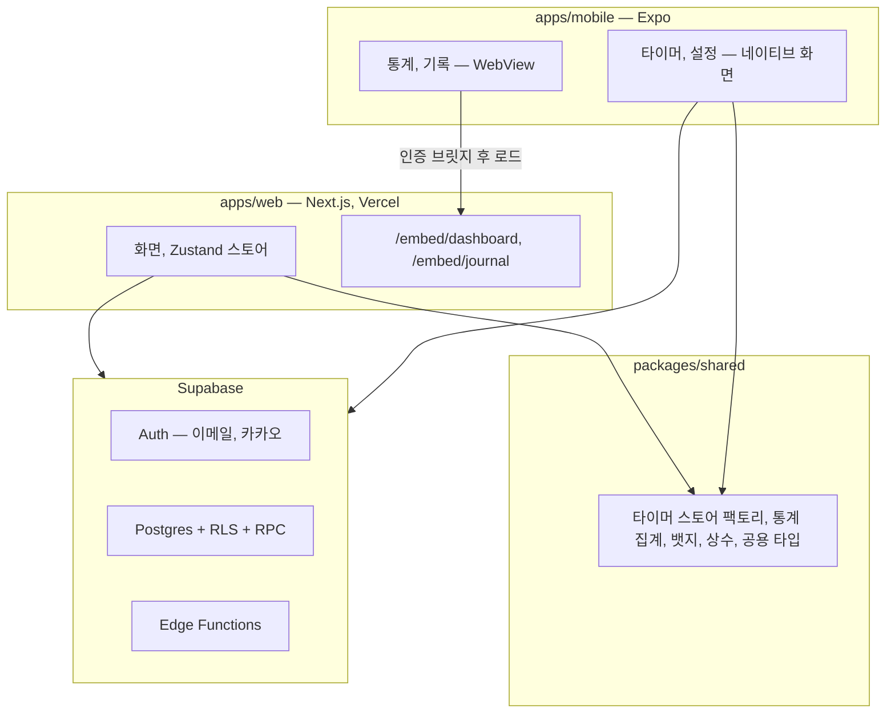
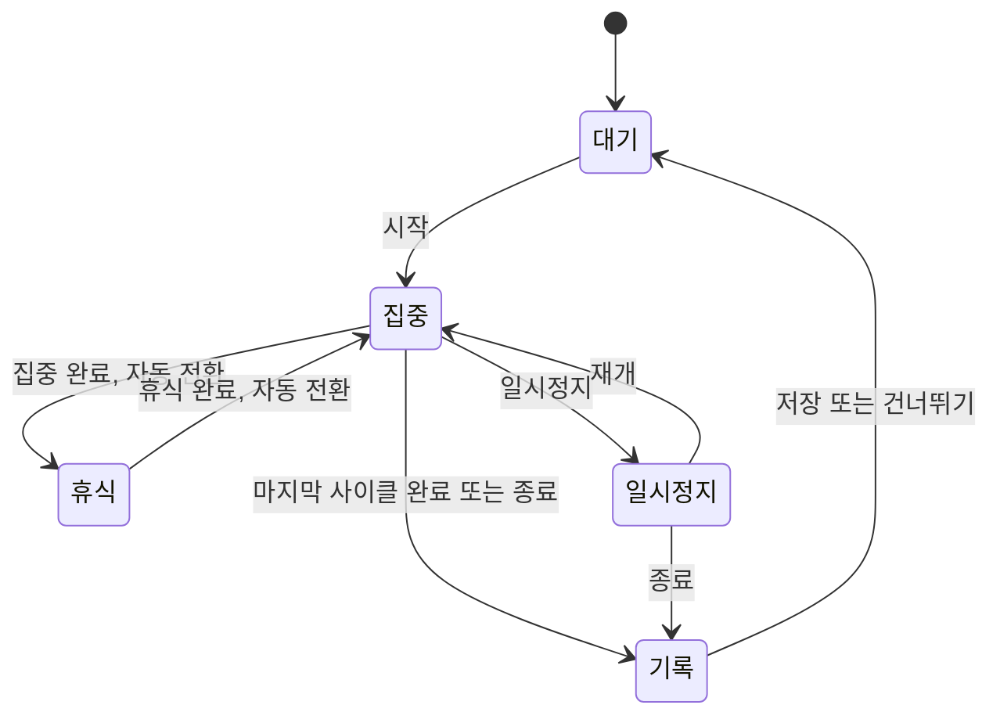
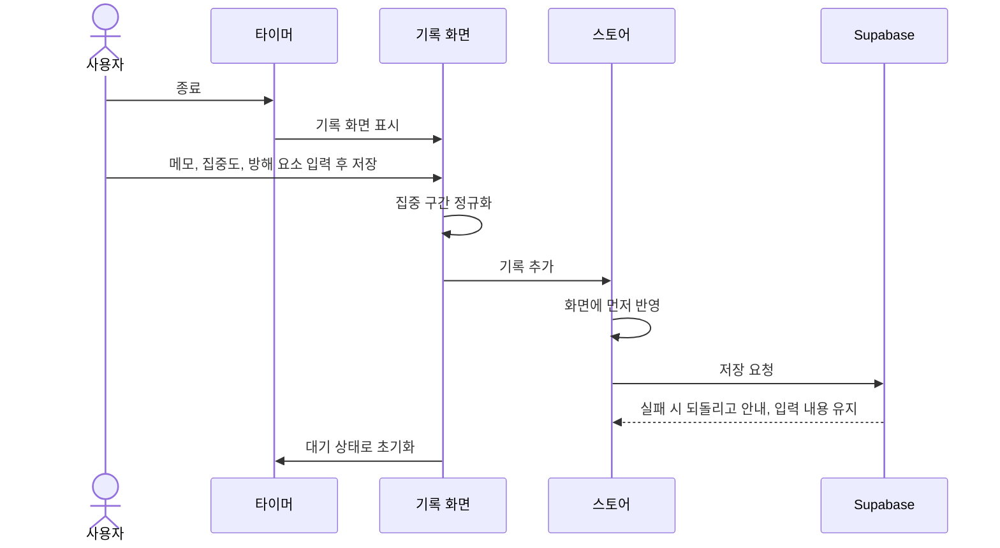

# 아키텍처

- pnpm workspace와 Turborepo 기반 모노레포
- 웹은 Next.js, 앱은 React Native와 Expo, 백엔드는 Supabase

## 1. 시스템 구조

| 구성 | 역할 |
|---|---|
| apps/web | 웹 서비스 전체와 앱이 WebView로 띄우는 embed 화면 |
| apps/mobile | 타이머와 설정은 네이티브, 통계와 기록은 WebView |
| packages/shared | 두 앱이 함께 쓰는 순수 로직 |
| Supabase | 인증, 데이터 저장, 통계 RPC, 카카오 로그인과 회원 탈퇴 같은 서버 작업 |

## 2. 핵심 설계 결정

**웹과 앱의 로직 공유**
- 타이머 상태 머신, 통계 집계, 뱃지 판정, 입력 제한 상수를 `packages/shared`로 추출
- 같은 계산을 두 번 구현하지 않아 웹과 앱의 결과가 어긋나지 않음
- UI와 데이터 조회처럼 플랫폼마다 다른 부분만 각 앱에 둠

**저장소를 주입받는 타이머 스토어**
- 공용 타이머 스토어는 저장 방식을 모르고, 스냅샷 저장과 복원 함수를 외부에서 주입받음
- 웹은 localStorage, 앱은 AsyncStorage를 주입해 같은 스토어로 새로고침이나 앱 재시작 후에도 상태 복원
- 스토어는 전역 싱글톤 대신 팩토리로 만들어 SSR에서 요청 간 상태가 섞이지 않게 함

**하이브리드 앱 구조**
- 차트가 많은 통계와 기록 화면은 웹 화면을 WebView로 재사용해 두 번 구현하지 않음
- 앱이 가진 로그인 토큰을 웹의 브릿지 엔드포인트로 넘기면 웹이 세션 쿠키를 만들고 embed 화면으로 이동
- embed 화면은 웹 내비게이션을 빼고 콘텐츠만 표시

**낙관적 업데이트와 임시 ID**
- 작업, 카테고리, 기록 변경은 화면에 먼저 반영하고 저장에 실패하면 되돌림
- 생성 직후 서버 응답 전에 수정이나 삭제가 들어오면, 생성이 끝날 때까지 기다린 뒤 실제 id로 처리해 늦게 온 응답이 변경을 덮어쓰지 않게 함

**통계는 서버에서 집계**
- 스트릭과 월간 히트맵처럼 전체 기록이 필요한 통계는 Postgres RPC에서 계산
- 이 통계들은 클라이언트가 전체 기록을 받지 않고 서버가 계산한 결과만 받음

**기기에 남기는 데이터 최소화**
- 데이터는 모두 Supabase에 저장하고 기기에는 진행 중인 타이머 스냅샷과 테마만 저장
- 앱의 로그인 세션은 암호화해 AsyncStorage에 두고 암호화 키만 Keychain과 Keystore에 보관 — 보안 저장소는 항목당 용량 제한이 있기 때문

## 3. 타이머 상태

- 휴식 중에도 일시정지와 종료 가능
- 집중 시간이 30초 미만이면 기록 단계 없이 바로 대기로 돌아감
- 대기로 돌아오면 타이머 설정이 사용자 기본값으로 복원

## 4. 기록 저장 흐름

## 5. 관련 문서

- [ERD](ERD.md)
- [기능 명세](feature-spec.md)
