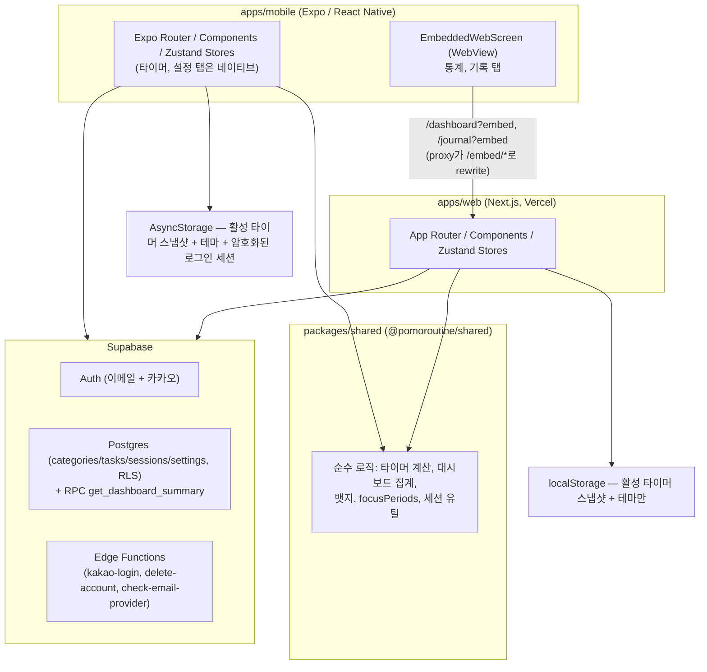
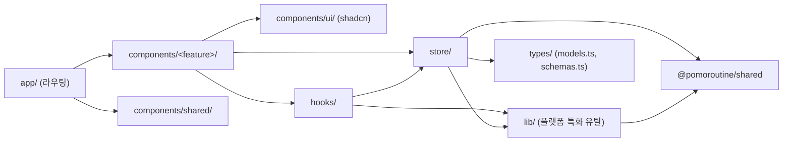
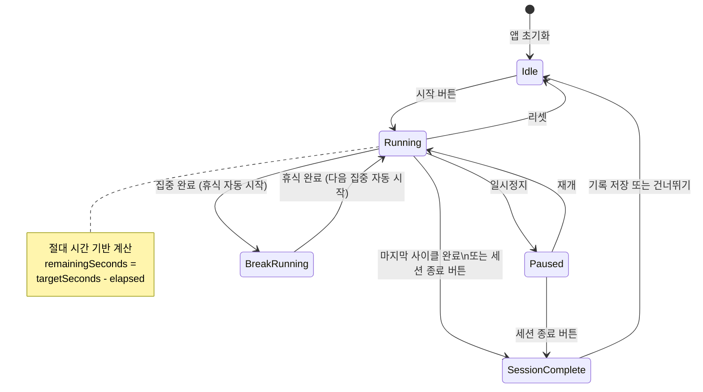
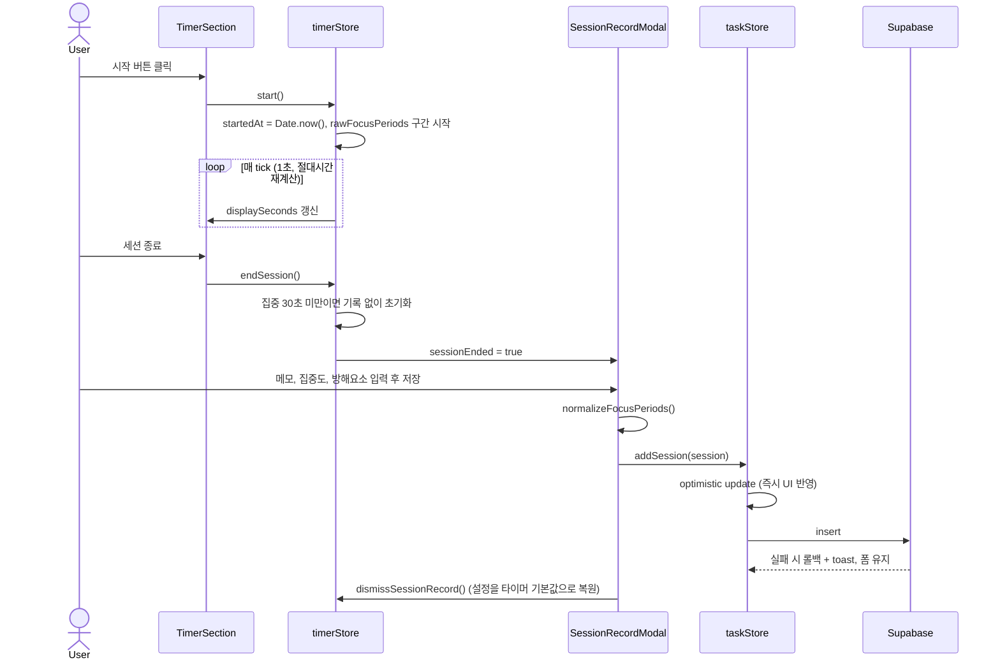

# 아키텍처 구조도

> **버전:** 2.1 · **기준:** pnpm 모노레포 + Supabase 백엔드 + 하이브리드 WebView (Phase 11 완료)

---

## 1. 시스템 전체 구조

Task/Category/Session/AppSettings는 Supabase가 단일 진실 원천이다. 기기 로컬 저장소(localStorage/AsyncStorage)에는 새로고침 복구용 활성 타이머 스냅샷과 테마, 모바일의 암호화된 로그인 세션만 남는다.

모바일의 통계, 기록 탭은 웹의 embed 라우트를 WebView로 띄운다. 네이티브 로그인 세션은 인증 브릿지(`webviewAuthBridge`)로 WebView 쿠키에 넘긴다.

---

## 2. 컴포넌트 의존성 계층 (apps/web 기준)

단방향 의존만 허용한다. `lib/`에서 `components/`나 `app/`을 import하는 역방향 의존은 금지한다. apps/mobile도 동일한 계층 규칙을 따르며, 플랫폼 무관 순수 로직은 `packages/shared`로 뽑는다.

---

## 3. 타이머 상태 기계

---

## 4. 세션 데이터 흐름

---

## 5. 스토어 구성

| 스토어 | 주요 상태 | 주요 액션 |
|--------|-----------|-----------|
| timerStore | phase, mode, startedAt, remainingSeconds, cycleCount, rawFocusPeriods, defaultSettings | start, pause, complete, reset, endSession, syncDefaultSettings |
| taskStore | tasks[], categories[], sessions[] | addTask, updateTask, deleteTask, addSession, updateSessionFields, addCategory, deleteCategory |
| settingsStore | AppSettings 필드 (nickname, soundType 등) | setNickname, setTimerDefaults, setSoundType, addMessage 등 |

세 스토어 모두 `createStore()` 팩토리 패턴을 쓴다(SSR/RN 양쪽에서 싱글톤 버그 방지). 그중 `timerStore`만 `packages/shared`의 `createTimerStore(ports)`를 웹/모바일 각자 감싸 localStorage/AsyncStorage 포트를 주입하고, `taskStore`/`settingsStore`는 플랫폼별로 각자 구현한다(Supabase 클라이언트 호출 방식 차이). `StoreProvider`가 settingsStore의 타이머 기본값 변경을 구독해 `timerStore.syncDefaultSettings()`로 넘기며, 타이머는 세션 진행 중이 아닐 때만 이 값을 반영한다. 참조: [conventions.md](../guides/conventions.md)

---

## 6. 참조

- 폴더 구조 규칙: [docs/guides/conventions.md](../guides/conventions.md)
- 데이터 모델 / Supabase 스키마: [docs/specs/ERD.md](ERD.md)
