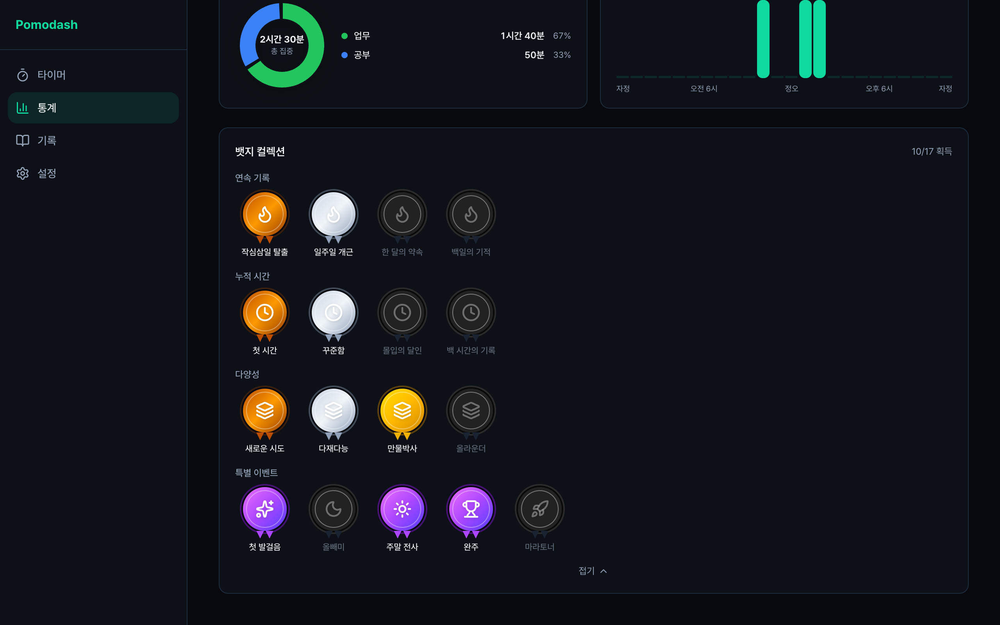
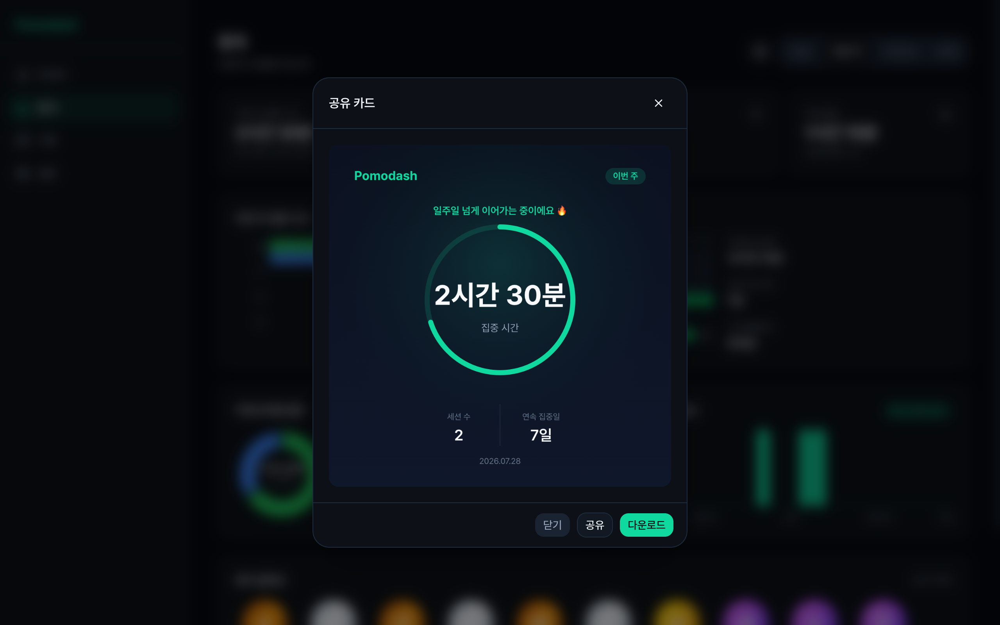
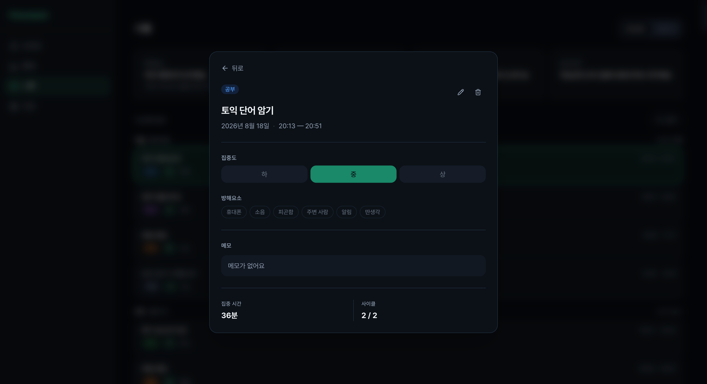

# 화면 명세

- 웹 기준으로 작성하고 앱도 같은 화면 구성과 동작을 따름
- 앱의 통계와 기록 탭은 웹 화면을 WebView로 그대로 표시

## 목차

1. [공통 레이아웃](#1-공통-레이아웃)
2. [타이머](#2-타이머)
3. [집중 모드](#3-집중-모드)
4. [통계](#4-통계)
5. [기록](#5-기록)
6. [설정](#6-설정)
7. [로그인과 회원가입](#7-로그인과-회원가입)
8. [랜딩](#8-랜딩)
9. [약관과 개인정보처리방침](#9-약관과-개인정보처리방침)

---

## 1. 공통 레이아웃

**내비게이션**
- 탭 4개 — 타이머, 통계, 기록, 설정
- 화면 너비에 따라 형태 변경

| 너비 | 내비게이션 |
|---|---|
| 640px 미만 | 하단 탭 바 |
| 640px – 1024px | 좌측 아이콘 사이드바 |
| 1024px 이상 | 좌측 전체 사이드바 |

**모든 화면 공통 요소**
- 미니 타이머 — 타이머가 돌고 있을 때 다른 화면에 떠 있고, 누르면 타이머 화면으로 이동
- 방치 안내 — 일시정지한 타이머를 오래 방치하면 이어가기, 종료하고 기록, 폐기 중 선택

**테마**
- 다크 모드 기본, 라이트 모드와 시스템 설정 연동 지원
- 포인트 색은 컬러 테마 4종 중 선택

---

## 2. 타이머

**경로** `/`

**화면 구성**
- 현재 작업의 카테고리와 제목
- 원형 진행 링과 남은 시간, 현재 상태 표시
- 사이클 진행 점 — 자유 모드에서는 숨김
- 집중 모드, 시작과 일시정지, 종료 버튼

**타이머 시작 화면**
- 작업 선택 — 목록에서 고르거나 새 작업 추가, 선택 안 해도 시작 가능
- 타이머 방식 — 포모도로 또는 자유
- 이번 타이머 설정 — 집중, 사이클, 휴식 시간, 초기값은 설정의 타이머 기본값

**기록 화면** — 타이머가 끝나면 표시
- 완료한 사이클과 집중 시간 요약
- 작업 없이 시작했다면 작업 지정
- 회고 메모, 집중도, 방해 요소 입력
- 기록 완료 또는 건너뛰기, 둘 다 한 번 더 확인
- 비회원에게는 기록 대신 로그인 안내

**주요 인터랙션**

| 동작 | 결과 |
|---|---|
| 처음 시작 버튼 | 타이머 시작 화면 열림 |
| 시작 화면에서 시작 | 선택한 작업과 설정으로 타이머 시작 |
| 일시정지 후 시작 버튼 | 시작 화면 없이 바로 재개 |
| 집중 모드 버튼 | 집중 모드로 전환, 실행 중에만 활성 |
| 종료 버튼 | 확인 후 기록 화면 표시 |
| 사이클 완료 | 다음 단계 자동 시작 |

**엣지 케이스**
- 작업이 하나도 없으면 시작 화면에 빈 상태와 작업 추가 버튼 표시
- 집중 30초 미만에서 종료하면 기록 화면 없이 초기화하고 안내

---

## 3. 집중 모드

**경로** 타이머 화면 위 전체 화면 오버레이

**화면 구성**
- 크게 키운 진행 링과 남은 시간
- 일정 간격으로 바뀌는 동기부여 메시지
- 나가기 버튼과 단축키 안내

**주요 인터랙션**

| 동작 | 결과 |
|---|---|
| 나가기 버튼 또는 ESC | 집중 모드만 종료, 타이머는 계속 진행 |
| 스페이스 | 일시정지와 재개 |

---

## 4. 통계

**경로** `/dashboard`

**화면 구성**
- 기간 탭 — 오늘, 이번 주, 이번 달, 전체
- 요약 카드 4개 — 집중 시간, 기록 수, 연속 집중일, 기록당 평균과 직전 기간 대비 증감
- 구간별 카테고리 누적 막대 차트
- 카테고리 비율 도넛 차트
- 시간대별 집중량 차트
- 이번 달 히트맵
- 뱃지 모음
- 공유 카드 버튼

**주요 인터랙션**

| 동작 | 결과 |
|---|---|
| 기간 탭 전환 | 요약 카드와 막대, 도넛, 시간대별 차트를 다시 계산 |
| 공유 버튼 | 현재 탭 기준 공유 카드 생성 |
| 뱃지 모두 보기 | 미획득 뱃지까지 펼침 |
| 뱃지에 마우스 올림 | 이름과 획득 조건 표시 |

히트맵은 항상 이번 달, 뱃지는 항상 전체 기록 기준으로 기간 탭과 무관

**엣지 케이스**
- 기록이 없는 차트는 아직 기록이 없다는 빈 상태 표시
- 비회원은 로그인 안내 표시

---

## 5. 기록

**경로** `/journal`

**화면 구성**
- 상단 인사이트 4종 — 방해 요소 상위, 집중도 추이, 카테고리별 집중도, 집중도 낮은 요일
- 목록 탭 — 날짜별로 묶은 기록과 검색, 카테고리, 기간 필터
- 캘린더 탭 — 월별 그리드, 날짜별 집중 시간 표시
- 기록 상세 — 모바일은 하단 시트, 데스크톱은 중앙 팝업

**주요 인터랙션**

| 동작 | 결과 |
|---|---|
| 목록과 캘린더 탭 전환 | 인사이트는 그대로 두고 아래 영역만 전환 |
| 기록 선택 | 기록 상세 열림 |
| 캘린더 날짜 선택 | 그날 기록 목록 열림 |
| 상세에서 편집 | 제목, 작업, 집중도, 방해 요소, 메모를 한 번에 편집 후 저장 또는 취소 |
| 상세에서 삭제 | 확인 후 삭제하고 상세 닫힘 |

**엣지 케이스**
- 기록이 없으면 빈 상태와 타이머로 이동 버튼
- 필터 결과가 없으면 검색 결과가 없다는 안내
- 캘린더의 미래 날짜와 기록 없는 날은 선택 불가
- 비회원은 로그인 안내 표시

---

## 6. 설정

**경로** `/settings`

첫 화면은 메뉴 4개 목록이고, 하나를 고르면 해당 화면으로 이동

| 메뉴 | 구성 |
|---|---|
| 계정 | 닉네임, 비밀번호 변경, 로그아웃, 회원 탈퇴 |
| 환경설정 | 테마, 타이머 기본값, 작업 관리, 카테고리 관리, 동기부여 메시지 — 각각 모달로 열림 |
| 알림 | 브라우저 알림, 화면 꺼짐 방지, 소리 알림의 종류와 음량, 반복 횟수 |
| 앱 정보 | 버전, PWA 설치, 약관, 랜딩 링크 |

**주요 인터랙션**

| 동작 | 결과 |
|---|---|
| 닉네임 저장 | 즉시 저장 후 저장됨 표시 |
| 타이머 기본값 변경 | 즉시 저장, 대기 중인 타이머 화면에 바로 반영 |
| 작업 관리에서 카테고리 관리 | 카테고리 목록이 위에 겹쳐 열리고, 편집은 그 위에 한 번 더 열림 |
| 소리 알림 끔 | 종류, 음량, 반복 옵션 비활성 |
| 브라우저 알림 켬 | 권한 요청, 거부하면 꺼진 상태 유지 |

**엣지 케이스**
- 동기부여 메시지가 하나 남으면 삭제 불가
- 작업이 쓰는 카테고리는 삭제를 막고 안내
- 비회원은 로그인 안내 표시

---

## 7. 로그인과 회원가입

**경로** `/login`, `/signup`, `/forgot-password`, `/reset-password`, `/welcome`

**주요 인터랙션**

| 동작 | 결과 |
|---|---|
| 이메일 회원가입 | 인증 메일 발송, 링크를 누르면 가입 완료 화면 |
| 카카오 로그인 | 첫 로그인 시 기본 카테고리와 설정 자동 생성 |
| 비밀번호 찾기 | 재설정 메일 발송 후 새 비밀번호 설정 |

**엣지 케이스**
- 카카오 로그인 실패나 취소 시 로그인 화면으로 복귀

---

## 8. 랜딩

**경로** `/landing`

- 검색 유입과 로그인 화면 로고, 설정의 앱 정보에서 들어오는 서비스 소개 페이지
- 첫 방문자는 랜딩을 거치지 않고 타이머 화면으로 바로 진입
- 구성 — 히어로, 핵심 특징, 기능 소개, 사용 흐름, 하단 CTA
- 시작하기와 체험하기 버튼은 타이머 화면으로 이동

---

## 9. 약관과 개인정보처리방침

- 회원가입 동의 문구, 랜딩 푸터, 설정의 앱 정보에서 모달로 열림
- 같은 내용을 `/terms`, `/privacy` 페이지로도 제공 — 외부 링크와 검색 노출용

---

## 관련 문서

- [기능 명세](feature-spec.md)
- [디자인 시스템](../guides/design.md)
